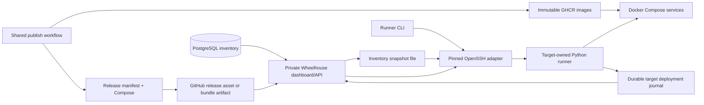

# Wheelhouse architecture

*Last updated: 2026-10-21*

## Runtime

A .NET 10 host serves the private administration API and Vue workspace.
PostgreSQL stores the inventory (products, servers, targets, vaults), integration keys, the audit trail, vitals and the
built-in Secrets Vault's encrypted secrets (schema `vault`);
bespoke SQL migrations run on startup. GitHub cookie authentication and an owner allowlist protect administration; a scoped integration key reads
the product catalog and nothing else. A deployed console (the runner sets `DEPLOY_ENVIRONMENT`) and Production require a
nonempty owner allowlist.

Deployed dev runs as .NET `Development` and prod as `Production` (`dotnetEnvironment: true` in `deploy.yml`), so
`appsettings.Development.json` holds defaults only. The IDE run's rig wiring — database `127.0.0.1:15432`, runner
paths, `Deployment:Rehearsal` — lives in the gitignored `appsettings.Local.json`, which the host reads right after
`appsettings.Development.json` only on a local run whose launch profile sets `LOCAL_SETTINGS=true` (the be sdk's
`AddSettingsFiles`): tests and containers never read it. A deployed console reads the `appsettings.Target.json` its
release bundle mounts instead. OpenAPI and an empty allowlist are local-run only, never `Development` alone.

## Responsibilities

| Layer | Responsibility |
|---|---|
| Domain | Product, server, target, vault, deployment, domain and secret models |
| Application | Inventory, workspace, status, integration key, audit, vault and deployment use cases |
| Infrastructure | SDK integration clients, the inventory snapshot exporter and the bounded runner-process adapter |
| Persistence | PostgreSQL EF mapping, repositories and bespoke migration files |
| API | Host wiring, authorization, request validation, controllers and SPA serving |
| Python runner | Inventory snapshot reads, release discovery, bundle validation, SSH, rollout, checks and recovery |
| Secrets Vault | The built-in module (schema `vault`): per-product data keys under a root key file, versioned encrypted secrets, the canary, imports |
| Vault gateway | The standalone vaults' management API: the fallback for one release (`Vault:Mode` `external`) and the import source |

Wheelhouse keeps business logic only: domain meaning, inventory and deployment use cases, version-resolution policy,
store predicates and settings values. Host wiring, data, web contracts, identity, integration clients, UI building
blocks and the test harness come from the wow-two SDKs; a new generic piece proves inline, then extracts in the next
Adoption version. snake_case is database-only (column names and stored enum values); the JSON wire stays camelCase.
Time comes from the SDK `TimeProvider`.

The placeholder deployment, domain and secret tables remain unused.
The deployment execution journal lives on each target, with a durable local submission index.

## Release contract

A release bundle holds `release.json` (schema version, product, release label, full source SHA, CPU platform, service
image digests, Compose SHA-256, required setting names, sites and whether its schema permits the previous images) and
`compose.json` (product-owned topology, named volumes, limits and health checks). Neither holds credentials,
environment-specific domains or database values; a target supplies its settings, so promotion changes settings, not
image bytes. The shared publish workflow builds bundles from each product's `deploy.yml`
([descriptor convention](../../../../../conventions/deployment/descriptor/deploy-descriptor.md)).
The runner reads two schemas: 1, from descriptor 1, keys `sites` by service with one path and an exposure each; 2,
from descriptor 2 (pipelines `v0.8.0`), carries the product's `sites` (exposure, primary, environments) and `routes`,
each service's port and paths per site. Both become one row per service site and one Traefik router per site path
([sites](../deployment/deployment.md#sites)).

Every service can read the environment it runs in from `DEPLOY_ENVIRONMENT` (`dev` or `prod`): the runner writes a
Compose override beside the release's `compose.json` (`environment.json`, never part of the bundle or its hash) that
sets it on each service, and passes it to every Compose call, so a product needs no descriptor change to know it. A
release whose descriptor sets `dotnetEnvironment: true` also gets `ASPNETCORE_ENVIRONMENT` and `DOTNET_ENVIRONMENT` —
dev `Development`, prod `Production` — in the same override; it is opt-in because a product's
`appsettings.Development.json` may still hold machine-local values. A changed override counts as a changed service.

A release may declare a dev check (`verify` in `deploy.yml`: a service, a command and a timeout, default 5 minutes,
10 seconds to 30 minutes), which the generator writes into `release.json` (pipelines `v0.5.0`).

### Release sets

A product built from several repositories (decision 70) releases as a set: one release of each of its repositories that
deploys something, composed on the control host (`release_sets.py`) into one schema-2 bundle that deploys, rolls back
release-wide and promotes like any other, so a target still runs exactly one release and only its changed services
restart. Each repository's `deploy.yml` names the product's slug, so each bundle, its asset (`<product>-release.tar.gz`)
and each service's platform name carry it; each repository keeps its own CI, `vX.Y.Z` tags and version track.

- **Identity.** A set's bundle ID is `<product>-set-<12 hex>`, the first 12 hex digits of the SHA-256 of its components'
  artifact IDs in repository order, so the same components always make the same set. Its release label names each
  component by its repository's short name (the name without the owner's or the product's prefix) and release, joined
  by `_` in repository order: `platform-v0.1.8_studio-v0.1.6_assets-v0.1.0`, or `set-<12 hex>` past 96 characters.
  The console reads it as `platform v0.1.8 + studio v0.1.6 + assets v0.1.0`, a pill as `platform 0.1.8 +2`.
- **Listing.** The release catalog lists a product's sets, never its repositories' own releases (one alone would drop the
  other repositories' services): after each repository release, once every deploying repository has published one, a
  set of that release and every other repository's newest then, newest first (50 at most); and per recent commit build
  of a repository (10 each) a candidate set beside the others' newest releases. Every listed set is remembered under
  `<runner root>/sets/`, so one that left the listing (an older set dev proved) still composes for prod.
- **Composition.** Each component is downloaded and checked against its own repository's release source (asset digest,
  commit, approved images) before the set is composed. Services, sites and named volumes keep their repositories'
  names and must be unique across them — a clash is refused naming both repositories, never renamed, since a rename
  would move a site's host or start a volume empty. The product's front door is the primary repository's primary site.
  A dependency may name another repository's service; the composition refuses an unknown one or a cycle. The set is
  rollback-compatible only when every component is; `migrations` is true when any says so; `dotnetEnvironment` is a list
  of the services whose repositories opt in when not all do; the first declared `verify` runs. `release.json` adds
  `set` and `components` (each repository's name, repository, release, kind, source commit and services);
  `sourceCommit` is the primary repository's.
- **Promotion.** Prod takes the very set dev proved (the dev rollout's bundle ID). The changelog compares two sets
  repository by repository and merges them (`components` keeps each repository's own).

Bundles are privileged owner inputs: hashes bind files together, not publishers to identities.
The API accepts target and release IDs only. It cannot upload arbitrary Compose, run shell commands or disclose SSH keys.

## Execution model

1. Validate the manifest, digests, Compose hash and environment identity; refuse a commit build on prod.
2. Take the target lock that the console and the runner CLI share; refuse an unresolved interrupted rollout.
3. Render every settings file the release mounts ([settings at deploy](#settings-at-deploy)); a required key no layer
   sets refuses the deploy before anything changes. Check Docker, Compose, the settings, free disk and release platform.
4. On prod, snapshot the product's databases and named volumes on the target; a failed snapshot fails the rollout. A
   volume holding a file database is archived while the containers writing to it are paused, so the copy is
   consistent — a SQLite file by its header, whatever its name, or a file named as another embedded database (`*.db`,
   `*.sqlite`, `*.litedb`, `*.mdb`, `*.duckdb`, `*.realm`, `*.wt`, `*.bdb`); other volumes are archived live. Pull
   every missing image before replacing any running container, under a sign-in made for that pull only
   ([registry sign-in](#registry-sign-in)).
5. Save durable intent and the previous successful bundle on the target.
6. Apply Compose service-aware: compare each service's definition (image digest included; `depends_on` left out), the
   environment override, its settings fingerprint (its settings file's contents) and the target's interpolation inputs
   with the release the target runs; recreate only the changed services, each alone, in dependency waves (Compose
   `depends_on`, rendered from `deploy.yml` `dependsOn`; `up --no-deps --force-recreate --wait` per wave) when that
   differs from one `up`, so a failing service leaves its dependents unstarted and a dependency's update never
   restarts a dependent; then converge the whole release with one `up --wait --remove-orphans --no-recreate`, which
   keeps unchanged services running untouched (`--force-recreate` instead when every service changed in one wave).
   Wait for every declared health check, then request each site through the ingress. A `depends_on` naming an unknown
   service or forming a cycle is refused before anything changes. Rollback stays release-wide, so a target always
   runs exactly one release.
7. Record the outcome with release, source commit, actor and previous release. On dev, a release that declares a dev
   check then runs it ([deployment automation](#deployment-automation)); the outcome stays what the rollout was.
8. On failure, keep the attempted release; restore previous images only under a declared schema-compatibility
   guarantee. Never restore a database or delete volumes automatically.

An SSH disconnect or control-plane restart does not stop the detached target worker; unknown or interrupted state
needs explicit reconciliation, not a blind retry. SSH uses strict host-key checking against a pinned known-hosts file,
batch authentication, explicit identities and a bounded timeout. Compose replacement has a restart window; there is
no zero-downtime promise.

## Settings at deploy

A console-driven deploy renders each service's settings file on the target (`render` on every inventory target; CI's
own targets keep their hand-placed files), into `<root>/config/<product>-<environment>/<service>.target.json`, mode
`0444` inside the mode-`0700` folder (`settingsRoot` replaces `<root>/config` on the local server). Layers, last wins:

| Layer | Source |
|---|---|
| Host file | The file the target names for the service, if any: the pre-render settings, kept as a layer |
| Wheelhouse | The environment's stored settings (`environment_settings`) and its built-in vault secrets, read at deploy |
| Derived | `AllowedHosts` (the hosts of the sites the service serves, its platform name `<product>-<environment>-<service>`, any other host its host file listed, `localhost`), `Sites:<site>:Url` (the origin of every site the product publishes there), `Deployment:TrustedProxies` (the address of the host kit's `ingress` on the target's network). A public site's host is the target's, else the server's pattern, else its baseline host on the server's public address (`<product>[-<site>][-dev].<ip-with-dashes>.sslip.io`, decision 68), so both keys name it |
| Database | A required connection key (`ConnectionStrings:<name>`, `<Section>:ConnectionString`) no other layer sets, from `config/<product>-<environment>/database.json` (`prepare.py --database`), for a service that needs PostgreSQL |

- A value goes to every service that declares its key (required, or a release's optional or secret declaration), and a
  key no service declares to every service that takes a settings file.
- The control plane sends the Wheelhouse layer on the submission's SSH stdin; the runner hands it to its worker over a
  pipe and writes it nowhere but the rendered files. Job records keep key names by source (`settings`), never a value;
  the render is the rollout's first step, `Render settings`.
- An identical render keeps the file; a changed one changes the service's settings fingerprint, so only that service
  restarts. A bind mount keeps the file a container started with until the container is recreated.
- An environment's secrets live in the built-in Secrets Vault ([below](#secrets-vault)), decrypted in process at the
  render. A sealed vault holds a deploy that needs secrets rather than drop one; metadata still reads.
- `GET /api/deployments/targets/{target}/settings[?release=]` (the release the target runs when none is named) lists
  each service's keys with their source (`derived`, `vault`, `stored`, `default`, `host`, `missing`, `unset`), type,
  whether each is required and secret (the release's declaration, else a guess from the key's name), a secret's
  metadata (version, who, when, fingerprint, expiry), the keys no service declares (`extra`: owner-added keys and values
  kept for undeclared keys), the keys changed since the target's last render (`unapplied`), a scheduled apply
  (`pending`) and the vault's state. Key names, non-secret values and versions only.
- `PUT …/settings` (action `settings`) `{ values: [{ key, value, secret, note?, expiry?, confirmPlain?, remove? }],
  release? }` saves in one transaction: each value is checked against its declared type, a key that reads as a secret
  (or is declared one) is refused as a plain setting unless `confirmPlain`, secrets become new vault versions, settings
  go to the store, a key moving between the two leaves the other, and `remove` takes a value out of both. One value is
  one field's save (the editors and the deploy dialog save field by field); several are a bulk edit that lands whole or
  not at all. Audited as `settings.save` with key names and versions, never a value.
- Products declare typed keys in `deploy.yml` (`settings.keys`: `text`, `number`, `boolean`, `choice` with values,
  `url`, `cron`, `date` with a format, `email`; required or optional with a default for non-secrets; pipelines
  `v0.10.0`). The bundle carries them as `settings.<service>.{optional, secrets, allowed, types}`, which the runner
  validates and passes on with each key. Owners add keys per product in the console
  (`PUT|DELETE /api/products/{product}/setting-keys/{key}`, typed the same way).
- A deploy, the owner's or an automatic one, is refused while a required key has no source on a service without a host
  file, an owner-added required key included; the refusal is kept as a deploy that changed nothing. The deploy dialog
  lists those keys and, on a first deploy, the release's optional ones; each field saves as it is confirmed, so partial
  progress survives closing the dialog, and a required key without a saved value holds the deploy.
- Each submitted deploy records its render in `deployment_renders`: every key's kind with a secret's version and keyed
  fingerprint or a setting's digest, never a value, and the keys changed against the render of the target's last
  successful deploy. A deploy that changed settings and then failed, rolled back, regressed or failed its check shows
  them on its detail page and in Issues as the likely cause (`settingsChanged`, `settingsSuspect`).
- An edit applies by rendering again: `POST …/settings/apply` (action `settings`) `{ at?, reason?, confirm? }` deploys
  the release the target runs now, as a recorded deploy whose reason starts `Settings apply`; the rollout recreates
  only the services whose settings fingerprint changed (`--force-recreate --no-deps`). With `at` it is scheduled
  instead (`settings_applies`, one per target, within 90 days; `DELETE` cancels), and the pass every
  `Deployment:ApplySeconds` (60) submits it for the owner who scheduled it with the cause `settings_apply`, so a freeze
  refuses it like any automatic deploy.
- The target check weighs the keys Wheelhouse would send and names a required key no layer sets.

## Registry sign-in

Products hosts keep no registry token. For a release with GHCR images, the control host picks the first credential GHCR
accepts for pulling all of them — the GitHub App's installation token for their owner, else the token file
(`Deployment:GitHubTokenFile`) — by asking GHCR's token service first (`registry.py`). The chosen one travels on the
submission's SSH stdin; the target signs in only when an image is missing, with `docker --config <temporary folder>
login --password-stdin` (the folder in `/dev/shm` where the host offers it), pulls those images, signs out and deletes
the folder, whatever happened. Compose then pulls with `--policy missing`: digests make a present image exact. The job
keeps `registry` (`credential`: `installation` | `file` | null, and the ones GHCR `refused`), never a token.
`transport.py registry --root <runner root> [--product <slug>]` asks GHCR, per product and credential, whether it
grants each image repository a pull, and prints statuses only.

## Artifacts and registry

A product's release source — repository, archive name, build workflow and service-to-image mappings — is part of its
inventory row; `artifacts.py` approves only those. The release catalog lists published releases with a complete, checksummed asset and per-commit bundle artifacts;
drafts and incomplete assets never appear. Discovery covers the 100 newest releases per source; deployed bundles
stay in each target's journal. Selection downloads and validates the archive, its checksum, source commit and approved
image names before any target changes. Wheelhouse dispatches a product's build workflow only for a commit that has
no build; it never pushes, tags or builds on a host.

Images live in GitHub Container Registry, one repository per service; the digest is the deployment identity.
Keep every deployed digest and declared rollback dependency, and at least the 10 newest releases; candidate
bundle artifacts expire after 14 days. Deleting a release image needs a cross-host reference inventory first.
Every GitHub call carries the GitHub App's installation token for the owner it addresses, else the fallback token file
(`Deployment:GitHubTokenFile` / `WHEELHOUSE_GITHUB_TOKEN_FILE`), else another installation's token for public
repositories, else none; a credential goes only to the GitHub API and
is stripped from cross-origin redirects ([GitHub access](../deployment/deployment.md#github-access)). Release rules:
[deploy descriptor](../../../../../conventions/deployment/descriptor/deploy-descriptor.md) § *Builds and versions*.

A product of several repositories lists sets instead of its repositories' releases ([release sets](#release-sets)); its
builds, usage and failing-build reads cover every repository, and `branches`, `commits` and `build` take
`--repository` (the API's `repository`), defaulting to the primary one.

## Inventory

PostgreSQL is the source of truth for products, servers, targets (one product environment on one server) and vaults.
The console edits them; every change is an audited command. The API exports the four tables to
`<runner root>/inventory.json` at startup and after each change — atomically, owner-only, one write at a time — and
the runner reads only that snapshot, refusing a malformed one whole. The runner CLI keeps working from the last
snapshot while the API is down.

A server's ingress row carries its public address (`publicAddress`), where its public sites' baseline hosts point.
Enrollment and Refresh kit record it with the kit's ingress; a server edit keeps it, so it is never typed.

Credentials never enter the database. A server's SSH identity and pinned host key (`ssh/<server>/identity`,
`known_hosts`) and a vault's administrator password (`vaults/<vault>/password`) are files the owner places on
the control host: a new row reaches nothing until its files exist, and a changed host address fails its pinned key.
Provider and environment values stay enums; a new provider needs an enum member and its integration. A product or
server that a target or vault still uses cannot be deleted. Product images never change with the host.

On the local rig the runner holds the local server's fixtures. The API seeds them at startup: fixture products only
where the database lacks them, the local server, its targets and vault rewritten on every start, since their hosts,
ports and paths depend on where Wheelhouse runs. Fixtures never apply outside the rig. Every product runs `dev` and `prod` on one host, separated by Compose project, network alias,
database, settings files and hostnames. Moving a stateful product needs a backup, a write freeze, a verified restore
and an explicit cutover; a second host definition does not make a service redundant.

## Product catalog

A product is one inventory row: slug, name, description, repository, default branch, an optional release source, its
workspace, its status and its deploy mode, and its further repositories (`products.components`, migration
`031-product-components`: each `{ repository, release }` after the primary, empty for a product of one repository,
decision 70). The slug never changes once created; the runner refuses a target or release source for a product the
snapshot lacks. The product's repositories are primary first, each listed once, and no two declare one service; the API
refuses a save that breaks it (`ProductRepositories`). `ProductDto.repositories` lists every repository with its short
name and release source; the product form's `components` replaces the further ones and a save without it keeps them.
The snapshot carries `components`; one environment set, one placement (databases `<product>_{dev,prod}`, folder
`<root>/<product>-<environment>/`), one secrets space and baseline hosts serve the whole product.
`/api/products/{product}/descriptor` reads every repository that deploys something and merges their services, needs and
sites, refusing a service or site two repositories declare; placement and the environment form read it. While the repository carries a valid manifest,
its name, description and homepage replace the row's ([product identity](#product-identity)).

The deploy mode (`products.deploy`, migration `025-product-deploy-mode`) is the catalog entry's `deploy`: `wheelhouse`
(Wheelhouse deploys it), `ci` (its own CI deploys it, as Wheelhouse itself) or `none` (nothing does). The catalog import
sets it, the product form edits it (`deploy` on `POST`/`PUT /api/products`; omitted, a new product takes `wheelhouse`
and a saved one keeps its own), and `ProductDto` carries it. Only a `wheelhouse` product takes automatic deploys and is
offered for promotion — Ready to promote, auto-promote and fleets leave the others out — and the console's pills read
CI for a `ci` product it has no target for. No check names a slug; the migration made the existing `wheelhouse` product
`ci` and every other `wheelhouse`. Inventory exports leave the mode out, and the owner can still deploy any product by
hand.

`/api/products` joins the inventory and the product identity: each product's environments come from its targets, each environment's sites from
the newest rollout this control plane saw succeed (no target is contacted; one address per site, the one nearest its
root), and its vault namespace is
`{product}-{environment}` on its server's first vault, else on the inventory's first (the control host's), where a
deploy's render reads it. The response carries no targets, releases or deployment state,
so an integration reads products without deployment concepts. The runner read is cached for 30 seconds.

### Workspaces

A workspace groups products, such as the platform apps or one's own ventures (`workspaces`: id, unique slug, name,
optional description, `sort_order`, audit timestamps). Every product belongs to exactly one: `products.workspace_id`
is required and restricts deletes, so a workspace holding a product cannot be removed (409). Migration
`010-workspaces` created the default workspace `own-ventures` ("Own ventures") first in the order and moved every
existing product into it. A product created without a workspace joins `own-ventures`, which comes back last in the
order if it was removed.

- `GET /api/workspaces` lists `{ id, slug, name, description, order }` in the owner's order; the owner's
  session or a `catalog:read` key reads it, since every product names its `workspaceId`.
- `POST /api/workspaces` `{ slug, name, description? }` adds one last; `PUT /api/workspaces/{id}` `{ name,
  description? }` renames it (the slug stays); `DELETE /api/workspaces/{id}` removes an empty one;
  `PUT /api/workspaces/order` `{ ids }` reorders, and the list must name every workspace exactly once (409 otherwise).
- `PUT /api/products/{product}/workspace` `{ workspaceId }` moves a product; `{product}` is the product's id or slug.
- Every write carries the action header `workspace` and is audited (`workspace.create`, `workspace.update`,
  `workspace.delete`, `workspace.reorder`, `product.workspace`). Workspaces are not part of the runner's snapshot.

### Status

A product and each of its services are `active` or `inactive`. Inactive is a display filter only: the console hides
inactive products and services until the owner asks to see them, while deploys, reads and integrations keep
working. `products.status` replaced the five-value lifecycle in `011-product-status` (paused and killed became
inactive, idea, building and live active). A service's status is a `service_statuses` row keyed by (`product_id`,
service key in `deploy.yml`); a service without a row is active, one status covers every environment, and the rows go
with the product. The key is taken as given, since the repository declares a product's services.

- `PUT /api/products/{product}/status` `{ status }` and `PUT /api/products/{product}/services/{service}/status`
  `{ status }`; `{product}` is the id or the slug. Both carry the action header `status` and are audited
  (`product.status`, `service.status` with subject `{product}/{service}`). A new product starts active.
- `ProductDto` carries `id`, `workspaceId`, `status` and `inactiveServices` (sorted keys); `/api/products` and the MCP
  `list_projects` tool share it.

### Pins

The owner pins products to keep them one click away in the sidebar's Products tree, in a custom order (`pins`: id,
owner = the signed-in GitHub login, kind, `workspace_id`, `product_id`, `service`, `sort_order`, `created_at_utc`).
Pins are products only since 2026-10-18: the API refuses `workspace` and `service` (400), and migration
`015-product-pins-only` deleted every workspace pin and turned each product's service pins into one pin of the product
(at its first service pin's place, unless the product was pinned already), renumbering each owner's order; it is
forward-only. The table keeps its shape and check constraint. An owner pins a product once (unique index with
`NULLS NOT DISTINCT`, PostgreSQL 15+), and a pin goes with its product (cascade). Pins are a preference: they never
reach the audit trail and are not inventory.

- `GET /api/pins` lists the owner's own `{ id, kind, workspaceId, productId, service, order }` in order.
- `POST /api/pins` `{ kind: "product", productId }` adds a pin last (201) or answers the existing pin on that product
  (200); `productId` takes the product's id (its slug also works). An unknown product, another kind, a `workspaceId`
  or a `service` is 400.
- `DELETE /api/pins/{id}` removes one (another owner's reads as 404); `PUT /api/pins/order` `{ ids }` reorders,
  and the list must name every one of the owner's pins exactly once (409 otherwise).
- Signed-in sessions only (`OwnerSession` policy): an integration key is authenticated, then refused with 403;
  writes carry the action header `pin`.

### Catalog hubs

Wheelhouse reads one YAML catalog from each hub in `Catalog:Sources` — a list of `{ Repository, Path, Ref }`, default
`wow-two/wow-two-ws`, `sulton-max/10x-ventures` and `ocharo-hq/ocharo-ws`, each `catalog.yml` at `main` (an empty
list reads those three) — validated options, read with the owner's GitHub App token through `GitHubRepositoryReader`
(`IRepositoryFileSource`). Each read checks every ref's head again, so a pushed catalog shows at once; a commit's file
stays cached. The format (`catalog: 1`, `hub`, `workspaces`, `entries`) and which hub owns which entries are owned by
wow-two-ws ([catalog convention](../../../../../conventions/development/repo/catalog/catalog.md)); Wheelhouse reads the
hub's name and an entry's slug, name, workspace, kind, deploy, purpose and repositories, and ignores `orgs`, `hubs`,
`status`, `local` and any key it does not know. The parser (YamlDotNet's representation model) names the line and the
field of the first problem.

- The hubs merge in settings order; every workspace and entry carries its hub's repository as `source`. A hub that
  GitHub cannot serve, without the file, malformed, or repeating a workspace or entry slug an earlier hub holds (the
  error names both hubs) keeps its error and lists nothing; the other hubs still list theirs.
- `GET /api/catalog` returns `{ sources: [{ repository, path, ref, name, commit, error }], workspaces: [{ slug, name,
  description, source }], entries: [{ slug, name, source, workspace, kind, deploy, purpose, repositories, productId }]
  }`; `productId` is the product with the entry's slug, else `null`. Always 200 for a valid setting; a failing hub
  shows in its `error`. Signed-in session only.
- `POST /api/catalog/import` `{ slugs }` (action header `catalog`, audited as `catalog.import`) walks the chosen
  entries in merged order: an existing product with the slug moves into the entry's workspace and takes the entry's
  `deploy` as its deploy mode, and its repositories when the entry lists others; an entry with
  `deploy: wheelhouse` and a repository becomes a product, one product for all its repositories; anything else is
  skipped with a warning (an entry with `repositories: []` is not importable, and one whose repositories share a service
  creates nothing). An entry's `replaces` names products it supersedes: each one no runner record shows a deploy to
  retires — its environments, then the product with its settings, secrets and pins — and one with deploys on record, or
  every one while the history cannot be read, stays with a warning. A workspace is created from its catalog declaration, last in the order, only
  when a product needs it. It answers `{ createdWorkspaces, createdProducts, movedProducts, updatedProducts,
  retiredProducts, warnings: [{ slug, message }] }` (slugs; `updatedProducts` names the existing products whose deploy
  mode or repositories changed); a second run changes nothing. A slug no readable hub lists is 400, naming each hub that could
  not be read, and nothing changes.
- A product created from the catalog needs no typed release config: name and description (clipped to 200) from the
  entry, the primary (first) repository and each further one, branch `main`, asset `{slug}-release.tar.gz` (every
  repository of a product publishes it), workflow `publish-docker-image.yml`, and, per repository, one image per service
  key of its `engineering/deployment/deploy.yml` at `main`'s head:
  the service's own `image`, else `ghcr.io/{owner/repo, lowercase}/{service}`, the shared publish workflow's
  convention (`release.py` `repository_of`). Without a readable, valid descriptor the product gets no images and the
  warning says why; a descriptor naming another `product` keeps its images with a warning.

### Product identity

A product's name, description, homepage and per-service name and description are text in `product/product.json` in its
repository (the [product manifest convention](../../../../../conventions/design/identity/product-manifest.md); service
keys are the `services:` keys of `deploy.yml`). The database holds only a projection: one `product_manifests` row per
product with the manifest values, the repository and branch, and the commit they were read from. A save never writes
the manifest; the repository is where identity is edited.

- A row is replaced only by a copy read at a newer commit. Nothing expires it on a timer.
- On a read, `ProductIdentityService` compares the branch head with the row's commit; a different head reads the file
  at that commit. The head comes from `GitHubRepositoryReader`, which keeps it 5 minutes, so GitHub is asked at most
  that often per branch; a commit's file verdict is kept per commit.
- `POST /api/products/{slug}/identity/refresh` (action header `refresh`, audited as `product.refresh`) reads the head
  again now and answers with the product; it answers 503 when GitHub cannot serve the branch, and the row stays.
- A newer commit with no manifest drops the row; the product reads as its own row again. A row also goes when the
  product's repository or branch changes, and with the product.
- A product of several repositories always reads as its own row (its catalog entry): each repository's manifest
  describes that repository, not the product.
- An invalid, oversized or unparsable manifest is ignored whole: the previous row stays and `identity.problem` carries
  one display-safe reason, never file content beyond a shortened key name. An unreadable repository changes nothing.
- `/api/products` and the `list_projects` tool return the effective name, description and homepage plus
  `identity { source, commit, problem, services }`; `source` is `manifest` or `record`.
- While a manifest governs, a save leaves the row's own name and description as they are, and the console shows name,
  description and homepage read-only with a note that they are edited in the repository. A push webhook from a future
  GitHub App and writes from Wheelhouse feed the same commit-keyed row.

### Product icons

Icons are repository files, never rows: the
[product icons convention](../../../../../conventions/design/identity/product-icons.md) fixes their paths
(`product/brand/icons/{form}-{color}-{theme}.{svg|png}`, and `…/services/{service}/…` per service) and the fallback
order. `GET /api/products/{slug}/icon` and `GET /api/products/{slug}/services/{service}/icon` take `theme`
(`light`|`dark`), `form` (`full`|`short`) and `color` (`colored`|`monochrome`), default `light`, `short`, `colored`.
`ProductIconPaths` computes the candidate paths; the host reads the branch's newest commit (re-read every 5 minutes),
lists that commit's tree once (a commit never changes, so its listing and files stay cached until the branch moves),
keeps only the files an icon can come from — the icon and manifest sources share `GitHubRepositoryReader`'s head and
per-commit caches — picks the first candidate that exists, then the web
app's `favicon-dark`/`favicon`, and answers not found when nothing resolves, so the console shows its monogram. The
console asks for the theme of its active color mode and asks again when the mode changes. A file above 256 KiB is not
read, and every response is a download with `nosniff`, so a repository's SVG never runs on the console's origin.

## Integrations and agents

Another program — an app, a script, Claude or Codex — reads Wheelhouse with an integration key: the SDK `ApiKey`
scheme with the `wh_` marker. Only the secret's SHA-256 and a display prefix are stored; the secret is shown once;
a key can be revoked and shows its last use. A key grants scopes, `catalog:read` or `deployments:read`, and reaches only endpoints
whose policy names the key scheme; every other endpoint stays cookie-only through the default-deny fallback, and
key management is the owner's alone. A key's actions audit as `key:{name}`.

Whoever performs an action is its **actor**: a signed-in user's login, or `key:{name}` for an integration key (later,
automation). `IActorContext` names it once per request for commands, the runner and the audit trail alike. The trail
stores and hashes it as `actor`, as it always has; the API's DTOs, the MCP tools' output and the console all say actor.

The private `/mcp` endpoint uses the SDK's stateless Streamable HTTP host (`Ai/Mcp`). Every request authenticates
with a Bearer integration key; browser cookies are excluded. Before authentication, a request whose `Origin` is
neither the console's own nor in `Mcp:AllowedOrigins` gets 403, a request without one (a CLI client) passes, and a body
over 64 KiB gets 413. Every `/.well-known/*` path answers 404 rather than the SPA shell, so an OAuth discovery probe
learns that the endpoint takes keys only. Tool discovery and invocation both enforce scopes.
`catalog:read` lists projects; `deployments:read` lists servers, targets and deployment history and reads target
state, readiness, vitals and control-plane health. Tools call existing mediator queries. A scope has one projection
for REST and MCP alike: `list_projects` returns the `ProductDto` list `/api/products` returns, vault namespaces
included, and never a secret value; the fleet tools' projections omit credential and settings paths. The
[MCP runbook](../deployment/mcp.md) owns connection details. No initial tool writes, builds, deploys, reconciles, reads
logs or reveals secrets.

A failed tool call is an MCP tool error (`isError`) whose text is `{ code, message, retryable }`: `code` is the SDK
error kind REST puts in a problem's `code`, `message` the display-safe text REST returns as `detail`, and `retryable`
is true only for transient kinds, a runner timeout (`OperationTimeout`) or an unreachable runner or SSH host
(`ExternalUnavailable`). Any other exception is logged and answers its kind's generic message, so exception text never
reaches an agent. A refused scope stays a JSON-RPC error.

Future mutation tools require explicit scopes and the same handler/runner gates as the console: prod takes only a
release that passed dev, and bypassing that gate requires its typed target ID. They remain backlog work.

## Deployment outcome observation

The target journal owns a rollout's state. The control plane keeps durable submissions in `jobs/` and their latest
observations in `observed/`; history and statistics read that projection. A cancellable hosted follower asks the
existing process gateway for bounded observation passes. It scans all submissions, persists retry timing in
`following/`, and resumes after restart without launching work. Browser status reads share a nonblocking per-job
lock; competing reads get the last complete observation. Unique atomic temporary files prevent concurrent writers
from sharing a temporary pathname. Explicit reconciliation receipts take precedence over earlier observations.

A terminal status without `completedAt` is still being finalized: the worker may be rolling back or cleaning up.
The follower stops observing only completed outcomes. Explicit status reads can refresh a completed failure after
direct target-side acknowledgement. Transport failures and unknown receipts do not become rollout failures or
automatic retries. Missing receipts still require manual recovery. This projection does not introduce deployment
database ownership or mutation MCP tools.

### Deployment history

The runner's `history` action (`history.py`) returns every submission with its last observation, what its cached bundle
declares (product, kind, branch, rollback compatibility, each service's image digest and version, when its source
published it), how its rollout treated each service (`serviceRollout`, read from the observation) and, while it is
live, the step it is on; `observation --job` returns one submission's steps, sites and warnings. Both read local files only. `RunnerDeploymentRecords` holds one history read for
`Deployment:HistorySeconds` (3) so a page's concurrent reads share one runner process, and skips a malformed record.
`DeploymentHistoryService` joins it with the inventory: target → product and environment (a removed target keeps the
bundle's product and the environment recorded at submission), product → workspace, the target's previous success, and each service against
it (changed when the image digest differs; every service is new on a target's first rollout). Deploys that never
reached their target — refused by a freeze, a promotion gate or the runner's validation, replaced in the queue by a
newer release, dropped when their automation was turned off, and (once schedules exist) expired or aborted — are
`deployment_intents` rows the control plane writes (migration `026`, slugs rather than keys so a row outlives its
target); the history joins them beside the runner's records with the runner's `rejected` status, so integrations
reading the status see they changed nothing. The API filters and aggregates; nothing else is stored.

`DeploymentStateRules.Of(record, watch, intent)` reads every deployment into the status taxonomy, carried on every item
beside the old `status` and `outcome` (kept one release for integrations): `state` — `in_progress` | `succeeded` |
`degraded` | `rolled_back` | `partial` | `failed` | `not_applied` | `unknown`, by what the environment runs because of
it; `substate` (closed lists: queued, checking, draining, starting, verifying, rolling_back · watching, passed,
unverified, replaced · at_deploy, in_watch, side_effect · automatic, together · stopped_mid_rollout,
partly_rolled_back · rollback_failed, rollback_not_allowed, interrupted, first_deploy_unhealthy · refused, cancelled,
superseded, expired, aborted, check_failed, interrupted · no_receipt, unreadable); `attention` — `none` | `info` |
`look` | `act` | `muted`, which the console colours by; `cause` `{ kind, origin, message, at }` (kind service, step,
gate, freeze, validation, platform, busy, runner or operator); `effects` `[{ service, finding, via, at }]`; and
`services` `[{ service, result, origin, from, to, health, reason }]` in rollout order (result updated, new, unchanged,
not_reached, restored, failed, affected, waiting, starting or unknown). From the runner: `succeeded` is Succeeded,
or Degraded with warnings, an unhealthy service or a regression in its watch; `failed` before containers changed is
Not applied · check_failed, after it Partial (some services on the new release, some not) or Failed; `rolled_back` is
Rolled back; `rollback_failed` is Partial · partly_rolled_back when some services were restored, else Failed;
`interrupted` is Failed after changes and Not applied before; `rejected` is Not applied · refused. A failing service
is an effect of another only when it declares a path to it and settled unhealthy after it; otherwise every failing
service is an origin — never a guessed edge.

- Filters, on every read below: repeated `workspace`, `product` and `service` (`product/service`) combine as a union —
  a service matches a deployment that changed it, or any deployment of its product whose bundle the runner no longer
  holds; `status` `all` | `needs-action` (attention act) | `look` (attention look) | `succeeded` (state succeeded) |
  `not-applied`, and the old `failed` (the old outcome: failed, rolled back, rollback failed, interrupted, a failed
  check included) and `refused` (as not-applied); `notApplied=true` lists the deploys that changed nothing beside the
  others, which every status but `not-applied` and `failed` leaves out by default; `latest=true` keeps each target's
  last applied deploy of a local day in the IANA zone `tz` (default `UTC`), hiding the earlier attempts that day, so a
  day that ended on a success reads as one and a failure nothing fixed still shows — which deploy is last follows the
  entities and range, never the status; `from` inclusive and `to` exclusive (ISO-8601). Malformed values are 400.
- `GET /api/deployments/history` pages newest first: `limit` 1-100 (25), and an opaque `cursor` of the last item's
  submission instant and id, so a new submission never shifts a later page. Each item carries product, workspace,
  environment, release, bundle, status and outcome (`succeeded` | `failed` | `refused` | `pending` | `unknown`), the
  taxonomy above, duration, changed services (null when the bundle is unknown) and, while live, the current step.
- `GET /api/deployments/history/activity?tz=` counts per local day in an IANA zone (default `UTC`, range six months,
  at most 731 days) the finished rollouts that changed the environment, by attention (`calm`, `look`, `act`, beside the
  old `succeeded` and `failed`), and, with `notApplied=true`, the deploys that changed nothing (`notApplied`); only days
  with one are listed, and the status filter and `latest` apply (`latest` counts days in this `tz`). The same applied rollouts name the range's five busiest products
  (`products`: succeeded and failed per product, most first).
- `GET /api/deployments/history/stats` measures the entities over the range (30 days by default) beside the range of
  equal length before it, as the runner's statistics always have, with `look` and `act` counts; the status filter does
  not apply, `latest` counts each target's last applied deploy of a local day in both ranges, and the deploys that
  changed nothing count only with `notApplied=true` — while `notApplied` always counts them and `superseded` the applied
  attempts a later deploy replaced on the same target that local day (in `tz`), so the console can say how many a
  latest-of-day view hides.
- `GET /api/deployments/running` lists live rollouts with their step; `GET /api/deployments/promotions` lists, per
  product and prod target, the newest release (never a commit build) that succeeded on dev and is not what prod runs —
  left out while a prod rollout of it runs or prod runs it or a later release.
- `GET /api/deployments/issues` lists the inventory targets that need attention, each judged by its latest rollout that
  succeeded, failed or is live (a refusal changed nothing and an unknown receipt proves nothing, so both are passed
  over): a failure there — `failed`, `rolled_back`, `rollback_failed` or `interrupted` — has had no success since, and a
  live one that started over 30 minutes ago is `stuck`. Each issue carries its `kind`, `at` (the failure's completion or
  the stuck rollout's start), the rollout as a history item and `needsReconcile`: true for a stuck rollout and for a
  `failed` or `rollback_failed` one that had replaced containers, which the runner refuses to deploy over until a
  reconcile. That flag reads local records only; the target's own state decides, so the console reads it before its
  reconcile dialog opens. Likely-locked targets come first, then newest first; a removed target is left out.
- `GET /api/deployments/issues/builds` lists the products whose newest finished run of their build workflow on the
  default branch failed (`failure`, `timed_out`, `startup_failure`): `{ product, workspace, runId, conclusion, commit,
  title, at, url }`, newest first; a later success clears one. The runner (`builds`) reads GitHub Actions at most every
  two minutes and keeps the read in `<runner root>/github/builds.json`; a product GitHub cannot serve, one without a
  build workflow and one the inventory lacks are left out. The console lists them in Issues, linked to the run.
- `GET /api/deployments/products/{product}/usage` (runner `usage`, read at most hourly into
  `<runner root>/github/usage-<product>.json`) answers what a product's builds cost over 30 days: GitHub Actions runs
  and their wall-clock minutes per workflow (300 runs at most; `complete` false beyond), and each service's GHCR package
  with its version count when the token may read packages. GitHub's API reports no container package size, so
  `storageBytes` stays null. The console has the client (`useBuildUsage`); the product page does not show it yet.
- `GET /api/deployments/{id}/detail` answers one deployment: each service from and to, the previous success, the
  observation's steps, sites and warnings (`observed` false when unreadable), `rollback`, the previous release,
  only when this rollout is what its target runs and its release declares the previous images compatible, and
  `serviceRollout` — `{ staged, waves, removed, services: [{ name, change, outcome, dependsOn, from, to, reason,
  health, at }] }`, change `added` | `updated` | `unchanged`, outcome `unchanged` (kept running) | `updated` | `failed`
  | `not_started` | `rolled_back`, `from` and `to` each a version (else the 12-hex image digest), reason `added` |
  `image` | `definition` | `settings`, health `healthy` | `unhealthy` | `unknown` (fields the runner did not record are
  null); null for a rollout the runner did not report it for. A deploy that never reached its target answers with
  `observed` false and no steps. The deployment page reads the item's state, cause, effects and per-service results.
  History items carry `fleetId` when a fleet rollout submitted them.
- `GET /api/deployments` (50 newest) and `GET /api/deployments/stats?days=` stay for Home, the product overview and the
  MCP `list_deployments` tool.

## Deployment automation

The control plane deploys on the owner's behalf with the actor `automation`: a hosted worker
(`DeploymentAutomationWorker`) runs one pass every `Deployment:AutomationSeconds` (120; 0 turns it off). Work outside a
request acts as `automation`, so every automatic submission goes through the ordinary audited deploy command
(`deployment.start`, detail `…, automatic: a new release`) with the same runner gates.

- **Auto-deploy to dev** is on per product unless the owner turns it off (`product_automation`, migration
  `016-deploy-automation`; a product without a row takes the defaults). A product whose deploy mode is `ci` (Wheelhouse
  itself, until it deploys itself) or `none` never deploys on its own, whatever its row says; the API refuses turning
  either choice on (409).
- **Release watcher:** for every auto-deploying product with a release source and a dev target, the runner's `latest`
  read lists its newest published release (one GitHub call per repository, pre-releases ignored); a product of several
  repositories names its newest release set, so any repository's release queues the set for dev. A product's first read
  only records its watermark (`release_watermarks`), so turning automation on never deploys a backlog; a release
  published after the watermark is queued for each dev target. A webhook can feed the same watermark later.
- **Queue:** one slot per target (`deployment_queue`), latest wins: a newer release replaces a queued older one. A
  queued deploy waits while its target runs a rollout, and is dropped when the owner turned its automation off, or the
  target already ran that release. A refused submission is dropped too; the audit trail keeps why. A release replaced
  in its slot and one dropped because its automation was turned off are kept as intents (Not applied · superseded or
  cancelled), as is every refusal of an inventory target (Not applied · refused, with the freeze, gate or validation).
- `GET /api/deployments/automation` lists every product's `{ product, autoDeployDev, autoPromote, ciDeployed, deploy }` and the
  queue; `PUT /api/deployments/automation/{product}` `{ autoDeployDev?, autoPromote? }` (action header `automation`,
  audited `product.automation`) changes the choices it names.
- **Watch window:** for `Deployment:WatchMinutes` (10; 0 turns the looks off) after each target's latest successful
  rollout, every pass asks the runner's `watch` (two targets at most, one look a minute each) to read the target's
  containers and request again every site that answered at the deploy. The first look is the baseline; a container
  that stopped, turned unhealthy or restarted since, or a site gone silent, marks the rollout `degraded` with its
  findings, and the Issues list raises it (`kind: degraded`). A clean window ends `passed`; a rollout replaced meanwhile
  is `replaced` (records written before the rename say `superseded`, which reads as `replaced`), and one no look could
  read `unverified`. The record lives in `<runner root>/watching/<job>.json` and
  history items carry it as `watch`.
- **Dev check:** once a dev rollout of a release that declares `verify` succeeds, the runner runs the check in the
  same worker, before the job completes and its watch window opens: step `Verify end to end` runs the command in a
  one-off container from the named service's release image (`docker run --rm --pull never`, the platform network,
  `no-new-privileges`, all capabilities dropped, 512 MB), with `DEPLOY_ENVIRONMENT`, `VERIFY_RELEASE`, `VERIFY_SITES`,
  `VERIFY_SITE_<SITE>` (the site's root, else its shortest path) and `VERIFY_SERVICE_<SERVICE>` passed by name and no
  settings file. Exit 0 passes; another exit,
  the timeout (the container is removed) or a check that cannot start fails it as a step and deployment warning, never
  the rollout. The job keeps `verification` `{ status (passed | failed), service, startedAt, completedAt, seconds,
  exitCode (null on a timeout, -1 when it could not run), detail, summary (the last output line, 300 characters) }`;
  history items and the deployment page carry it with `verifies` (whether the bundle declares one), and so do Ready to
  promote rows, so a manual promote shows it. Prod never runs it.
- **Auto-promote** is off per product until the owner turns it on. A release whose dev rollout `passed` its watch in
  the last hour — and its dev check, when its bundle declares one; a declared check with no result holds it too — is
  queued for each prod target that neither runs nor tried it (`auto_promotions`, migration
  `018-auto-promotions`: each release is tried once per target) and submitted with cause `automatic: promoted after its
  dev watch`. A frozen prod target and a prod on the local server, which needs its ID typed, are left to the owner;
  the dev-pass gate holds by construction.
- **Retention:** each pass also runs the runner's `retention`: downloaded bundles nothing recent uses go after a week,
  and each target prunes old release folders and uploads once a day, two targets a pass, under its deployment lock
  ([deployment operations](../deployment/deployment.md)).
- **Freezes** (`deploy_freezes`, migration `017-deploy-freezes`) hold deploys everywhere, to one product, or to one
  product's environment; the narrowest covering freeze names the hold. While a freeze covers a target, an automatic
  deploy is refused (`…; the automatic deploy was skipped`, audited, dropped from the queue) and an owner's deploy is
  refused (409) unless it sends `overrideFreeze: true` with a `reason` (400 without one). `GET /api/deployments/freezes`
  lists `{ id, scope, product, environment, reason, actor, at, covers }`; `POST /api/deployments/freezes`
  `{ product?, environment?, reason? }` freezes a scope once (a second freeze answers the first) and
  `DELETE /api/deployments/freezes?product=&environment=` lifts it (204); both carry the action header `freeze` and are
  audited `deployment.freeze` / `deployment.unfreeze` with subject `portfolio`, `{product}` or `{product}/{environment}`.
  Freezes bind the console and the API; the runner CLI stays the operator's own tool.
- **Deploy reason:** `POST /api/deployments` takes an optional one-line `reason` (300 characters at most), required to
  override a freeze or skip the dev pass (400 without one). The runner keeps it on the job (`deployReason`), history
  items and the deployment page carry it, and the audit detail ends `, reason: …`.
- **Rollback risk:** a promotion carries `rollbackCompatible` (false: a failed prod rollout cannot restore the previous
  images on its own) and `hasMigrations` (from the bundle's `migrations`, null while a bundle does not say), and the
  console shows them on Ready to promote rows. `GET /api/deployments/releases/{release}/facts` (runner `facts`) reads
  one bundle's `{ rollbackCompatible, migrations, sourceCommit, kind }` into the cache without contacting a target; the
  prod confirm step reads it.
- **Fleet rollouts** (`fleet_rollouts`, `fleet_rollout_items`, migration `022-fleet-rollouts`): from Ready to promote
  the owner picks several rows (or all) and promotes them to prod in one run. `POST /api/deployments/fleets`
  `{ items: [{ target, release, confirm? }], reason?, overrideFreeze? }` (action header `deploy`, audited
  `deployment.fleet`, subject `portfolio`, detail naming the fleet and each release) takes 1-20 items, each prod target
  once, each a release Ready to promote offers for it (409 otherwise), a local-server prod only with its typed ID
  (400), and refuses a frozen target unless it overrides with a reason (409/400) and while another fleet runs (409;
  one runs at a time, a partial unique index). It answers 202 with the fleet after submitting the first product. Each
  product then goes through the ordinary deploy command — freezes, the runner's gates, the reason and
  `deployment.start` audits apply, with the detail `, fleet <id>` and the runner keeping `fleetId` on the job — as the
  owner who started it, also from the background pass (`FleetRolloutWorker`, every `Deployment:FleetSeconds`, 10; 0
  off). The fleet waits for each rollout's finished outcome (a terminal status with its completion), stops at the first
  failure or refusal — the rest become `not_started` — and fails a product with no finished outcome after 30 minutes
  or missing from the runner's records after two. `POST /api/deployments/fleets/{id}/cancel` (audited
  `deployment.fleet.cancel`) stops it between products: the product it is on finishes. Its end is audited
  `deployment.fleet.end` with each status's count and why it stopped. `GET /api/deployments/fleets?limit=` (newest
  first, 1-50) and `GET /api/deployments/fleets/{id}` answer `{ id, actor, reason, overrideFreeze, status (running |
  succeeded | failed | cancelled), createdAt, completedAt, cancelRequestedBy, cancelRequestedAt, items: [{ position,
  product, target, bundleId, release, fromRelease, status (waiting | running | succeeded | failed | refused |
  not_started), deploymentId, detail, startedAt, completedAt }] }`. The Deployments page's Ready to promote rows take a
  multi-select with Promote selected and Promote all; the confirm dialog lists every product in order with what prod
  runs, its rollback-risk badges and changelog, a freeze override, the reason and each local prod's typed ID; Running
  now shows the running fleet's progress with Cancel, and Fleet rollouts lists the fleets that ended in the last day.
- **Wheelhouse itself** (decision 64): once its product's deploy mode is `wheelhouse`, prod deploys each release to
  `wheelhouse-dev` through the same watcher, queue and watch window, and its declared dev check (`self_check.py`)
  replaces CI's post-deploy checks. Its prod is never auto-promoted (the API refuses turning it on, 409) and never part
  of a fleet (400); `SelfDeploymentInterceptor` refuses an automatic cause, a missing typed ID or reason, and a
  promotion while a fleet runs (409, audited). The runner gates Wheelhouse targets on the site probe and rolls any of
  their releases back (expand-only migrations, decision 65); `GET /api/self-deployment` reads the console's own newest
  rollout back from the host's journal, which `SelfDeploymentBootReader` does at boot
  ([deployment operations](../deployment/deployment.md#wheelhouse-deploys-itself)).
- **Changelog at promote:** every `main` release's GitHub body lists its commits since the previous release above
  GitHub's generated notes (the shared publish workflow from pipelines `v0.4.0`, `release.py notes`); a product pinned
  to an older tag keeps GitHub's one-line note, and the compare commit list covers it. `GET /api/deployments/products/{product}/changelog?from=&to=`
  (runner `changelog`) returns the bodies of the releases published after `from` (what the target runs; omitted when it
  runs nothing, which shows the last ten) up to `to`, newest first, plain text cut at 20,000 characters, and the
  compare commit list (`compareUrl`, `commits`, `totalCommits`; null with a `reason` when GitHub cannot compare) with
  the changed files under a `Migrations/` folder. Ready to promote rows and the prod confirm step show it expandable;
  the console renders bodies as text and opens only `https://github.com/` links.

## Portfolio summary

`GET /api/portfolio/summary?weeks=12&tz=UTC` (the owner's session, like every deployment read; `weeks` 1–52, `tz` an
IANA zone, optional `to` the instant the current week contains) serves the Products page from the joined deployment
history (`DeploymentHistoryService`), as of `to`. Weeks start on Monday in `tz`, oldest first, the current one last.
Per product with a target or a recorded rollout — `{ product, workspace, succeeded, failed, environments }` — each
environment, dev before prod, carries `lastDeploy` (the newest rollout that changed or tried to change it: deploys
that changed nothing are skipped), `running` (the newest success, so the release serving), `lastAttempt` (a newer
deploy that changed nothing but needs a look, such as a failed check, which marks the pill's corner) — each `{ id,
release, status, outcome, actor, submittedAt, completedAt, reason, state, substate, attention, servicesOnRelease,
serviceCount, watch }` — and `weekly`, finished rollouts per week that changed the environment. Per workspace —
`{ workspace, succeeded, failed, weekly: [{ succeeded, failed }] }`. Only finished rollouts count in weeks, as the
activity calendar's days do; a rollout whose product the inventory no longer holds counts nowhere. Read-only; never
contacts a target. `/api/system/status` also names the `environment` the console serves — its `DEPLOY_ENVIRONMENT`
(`dev` or `prod`), else `prod` as Production and `dev` otherwise — so the Products page shows the console's own
CI-deployed version there.

## Secrets Vault

Secrets Vault is Wheelhouse's built-in module (decisions 59–63; the standalone repository goes inactive). Products get
secrets only from the deploy-time render; an edit applies by rendering again and restarting what changed.

- **Keys.** One root key file (`Vault:KeyFile`, else `{Deployment:Root}/vault/root.key`): base64 of 256 bits, the
  standalone vault's master-key form, root-only on the control host, never in the database. It wraps each product's
  data key (AES-GCM, bound to the product), which encrypts that product's secret values, each bound to its product,
  environment, key and version. The SDK's envelope cipher does both.
- **Sealed.** A missing or malformed key file, or one that does not open the canary (a random value under a key of its
  own, made on the vault's first write), seals the vault: metadata reads; values neither save nor render; deploys
  that need them wait; the console and Issues say why. The file is read at each use, so placing it unseals without a
  restart, and removing it seals.
- **Versions.** Every change to a secret is a new version: who, when, an optional note, its origin (a restore, an
  import) and a keyed fingerprint (an HMAC under a key derived from the product's data key: equal values show equal
  fingerprints, a guess cannot be tested). A restore writes an earlier value as a new version. Removing a secret stops
  it rendering and keeps its versions.
- **Expiry.** An optional `expiresAt` per secret; Issues and the vault status warn at 30 and 7 days and flag lapsed
  ones. A new value keeps the expiry unless the save names one.
- **Write-only.** No endpoint returns a value: the console sees key names, versions, fingerprints and expiry. Values
  leave the module only for a render, to the runner's stdin. Nothing logs a value, a key or a fingerprint.
- **Surface.** `GET /api/vault` (state, key file path, counts), `GET /api/vault/issues`, `POST /api/vault/verify`
  (decrypts everything: the restore proof), `POST /api/vault/import { vault }`, and per target
  `GET …/secrets/{key}/versions`, `POST …/secrets/{key}/restore`, `PUT …/secrets/{key}/expiry`. Owner session only:
  integration keys get 403, and MCP never reaches the module.
- **Command line.** In the console's container: `dotnet Wheelhouse.Api.dll vault status | verify | import --from-vault
  <slug> | import --from-db [--source-key-file <path>]` (the standalone database's connection string on stdin). JSON
  counts, audited as `cli`.
- **Import.** From a standalone vault's database (or a restore of its dump) under its master key — the root key file
  by default, when the owner kept the same key — every version keeps its number, author and time; over a listed
  vault's management API, each enabled secret's current value arrives as version 1 noting where it came from. Only
  namespaces named `{product}-{environment}` of a known product import; each value is decrypted again before the
  transaction commits, and any failure keeps nothing. A secret the vault already holds is skipped.
- **Fallback.** `Vault:Mode` `external` (one release only) makes deploys and the settings save use the standalone
  vaults again through the gateway: the inventory vault on the target's server, else the first, signing in with
  `vaults/<vault>/password` and reading with a namespace token that lives 10 minutes. Versions, expiry and types stay
  with the built-in mode.

## Workspace

The Products page lists the workspaces, then their products as cards or rows with a pill per environment and a
deploy trend; the sidebar's Products tree keeps the pinned products and the one last opened. A product page shows its
environment, verified release, observed services, resource readings and recent deployments; a contextual inspector
keeps the selected target, service or deployment. Home, Products, Deployments, Servers and the profile menu's pages
share the top bar, primary-action placement, account menu and theme choice. Frontend invariants:
[frontend guidelines](../development/frontend-guidelines.md#repo-specific-deltas).

The service map draws the validated Compose definition of the target's last successful release. It never runs
Compose interpolation or returns raw configuration: environment values, labels, commands, credentials and bind-mount
paths stay out. Runtime readings are a separate, timestamped overlay; an unknown observation stays unavailable,
never healthy or zero. `depends_on` shows declared startup order and shared networks show configuration, neither
an observed call. Health attaches only when the runtime and target-state readings name the same release, and the
runner withholds attribution when a rollout changes that state mid-read.

## Security and recovery

Wheelhouse stays private through a tunnel or private network.
Runtime secrets reach applications in rendered settings files, mounted read-only; cookie key volumes survive
container replacement. The dashboard receives safe failure categories; raw runtime logs stay on the target.
A database backup and the cookie and recovery keys must be recoverable without Wheelhouse. Wheelhouse's database
backup holds the `vault` schema encrypted; the root key file is never in it: the owner keeps an offline copy apart,
and a restore is proven by `vault verify` (the canary and every version decrypt).

Executable commands, directory layouts and the VPS wiring checklist are in
[deployment operations](../deployment/deployment.md).
